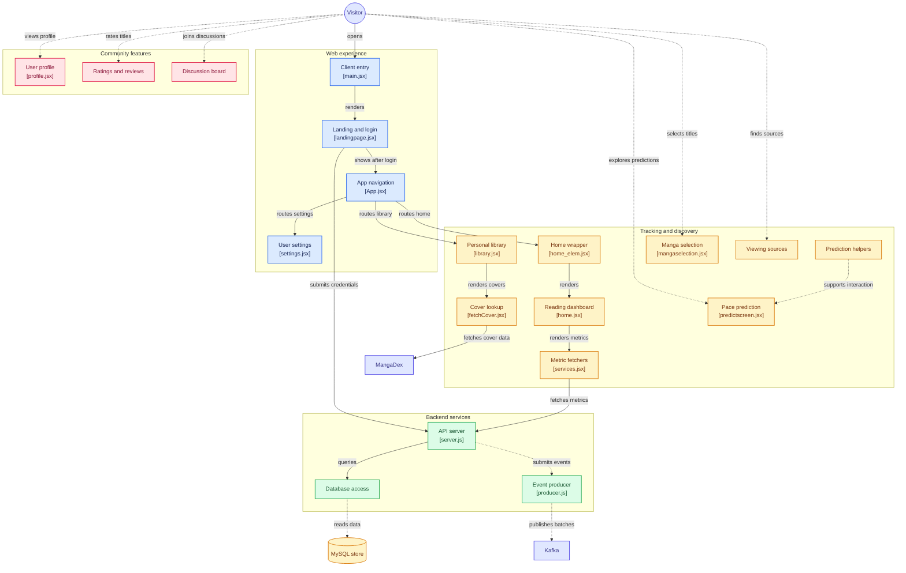

# MangaRoom [DISCONTINUED]

MangaRoom is a web application for anime and manga fans who want to discover current titles, track what they are watching, and connect with other viewers.

## About the App
MangaRoom helps users find ongoing anime, see where to watch episodes, rate series, and join discussions. The app combines a user-friendly frontend with a backend service to deliver recommendations, rating features, and community interaction.

## Key Features
- Browse ongoing anime and manga titles
- Display sources or platforms where content is available for free
- Personal library to track and organize anime/manga you're watching or reading
- User rating system for sharing reviews and opinions
- Discussion board for community conversation and recommendations
- User profiles with personalized preferences and history
- AI-powered prediction/recommendation system for discovering new titles
- User settings for customizing experience
- Responsive UI for desktop and mobile access

## Tech Stack

### Frontend

### Backend

## Architecture

### Tools & Libraries
- ESLint for code quality
- Shadcn UI components
- CORS for cross-origin requests
- Express Session for authentication

## Project Structure
- `mangaroom-frontend/`: web app UI, routing, and client-side logic
- `mangaroom-backend/`: API server, database handling, and producer logic

## Getting Started
1. Install dependencies in both frontend and backend folders
2. Run the backend server from `mangaroom-backend/`
3. Run the frontend app from `mangaroom-frontend/`

## Why MangaRoom?
MangaRoom is built to help anime fans stay up to date with ongoing series, share ratings, and talk about favorite shows in one central place.

